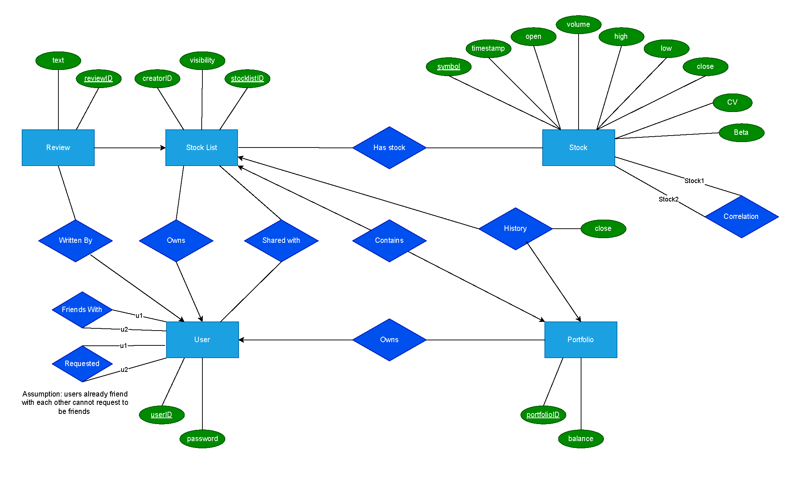

# Stock Portfolio Database 项目展示 / Stock Portfolio Database Project Overview

这是一个基于 **Java、PostgreSQL 与 JDBC** 开发的股票投资组合与社交功能数据库应用。项目围绕关系数据库设计、用户与好友关系、股票列表权限管理、历史股票数据处理及价格预测等功能展开。该项目由两人协作完成，从数据库建模开始，设计并实现了一个完整的股票投资与社交应用。

This is a database-backed stock portfolio and social networking application built with **Java, PostgreSQL, and JDBC**. The project focuses on relational database design, user and friendship management, stock-list access control, historical stock data processing, and stock price prediction. This project was developed by a two-person team and covers the full process from database modeling and relational design to application implementation.

---

## 精选代码 / Selected Code Samples

`selected-code/` 目录包含我在该双人项目中负责或参与实现的代表性代码摘录。

The `selected-code/` directory contains representative excerpts from the parts of the two-person project that I was responsible for or contributed to.

---

## 精选代码 / Selected Code Samples

`selected-code/` 目录包含我在该双人项目中负责实现的代表性代码摘录。

The `selected-code/` directory contains representative excerpts from the components I implemented in this two-person project.

- [`User.java`](selected-code/User.java) — 用户注册、认证与 BCrypt 密码哈希 / User registration, authentication, and BCrypt password hashing
- [`FriendRequest.java`](selected-code/FriendRequest.java) — 好友关系与请求管理 / Friendship and friend-request management
- [`StockList.java`](selected-code/StockList.java) — Stock List 管理与访问权限控制 / Stock-list management and access control
- [`HistoricalDataLoader.java`](selected-code/HistoricalDataLoader.java) — 历史股票数据批量导入与统计更新 / Historical stock data loading and statistical updates
- [`StockPrediction.java`](selected-code/StockPrediction.java) — SMA、EMA 与线性回归预测 / SMA, EMA, and linear regression prediction

更多说明见：

See more details in:

[`selected-code/README.md`](selected-code/README.md)

---

## 数据库设计 / Database Design

项目从 E/R 建模开始，进一步完成关系模式设计与 BCNF 规范化，并围绕用户、好友关系、Stock List、Portfolio 与股票历史数据建立核心数据模型。

The project begins with E/R modeling, followed by relational schema design and BCNF normalization for users, friendships, stock lists, portfolios, and historical stock data.

数据库设计图：

Database design diagram:



---

## 项目演示 / Project Demo

该项目主要以命令行应用形式运行。

A short terminal demonstration will be included to show the main application workflow.

```text
demo/
```

演示内容计划包括：

The demo will cover:

- 用户登录
- 好友关系管理
- Stock List 查看与修改
- 股票历史数据查询
- 股票价格预测

---

## 数据规模 / Dataset

项目使用约 **61.9 万条 S&P 500 历史股票日线记录**，包含：

- Timestamp
- Open
- High
- Low
- Close
- Volume
- Symbol

The project works with approximately **619,000 historical S&P 500 daily stock records**, including timestamp, OHLC prices, trading volume, and stock symbols.

---

## 说明 / Repository Note

本仓库用于求职和个人作品展示。

This repository is intended for portfolio and recruiting purposes.

由于原项目由两人协作开发，本仓库不会公开完整项目源码，仅展示我负责或参与开发的代表性代码摘录、数据库设计和项目说明。

Because the original application was developed as a two-person team project, this repository does not contain the complete project source code. It only includes selected excerpts from code I contributed to, along with database design materials and project documentation.

精选代码保持原项目的实现逻辑，仅进行必要的片段截取和展示说明。

The selected code samples preserve the implementation logic of the original project and are presented as excerpts for portfolio purposes.
